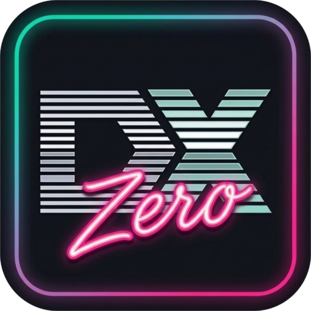

<div align="center">



# CardputerZero DX Zero

**6-Operator DX7 FM Synthesizer & 4-Track ORBIT/SLOOP Groovebox Sequencer for M5Stack CardputerZero (`APPLaunch`)**

*Created by **Adriano Dias Moraes***

[](releases/v0.1.0/dx-zero_0.1.0-m5stack1_arm64.deb)
[-FF6B2B?style=for-the-badge)](#installation)
[](CHANGELOG.md)

</div>

---

## Overview

**CardputerZero DX Zero** turns the pocket-sized **M5Stack CardputerZero** (`320×170` IPS display, 56-key matrix keyboard, ARM64 Linux) into a standalone **Yamaha DX7-compatible 6-operator FM synthesizer and 4-track groovebox**.

Play it **100% standalone** right out of your pocket using the CardputerZero's built-in speaker/headphones and keyboard, or expand it into a full studio rig by plugging in **any class-compliant USB MIDI controller** and/or **any USB audio interface**.

> **[IMAGE PLACEHOLDER: `assets/screenshot-hero.jpg`]**
> *Replace with a photo of M5Stack CardputerZero running DX Zero.*

---

## Releases & Downloads

| Version | Release Date | Package (ARM64 Debian) | Checksum | Notes |
|---|---|---|---|---|
| **`v0.1.0`** | 2026-11-20 | [`dx-zero_0.1.0-m5stack1_arm64.deb`](releases/v0.1.0/dx-zero_0.1.0-m5stack1_arm64.deb) | [`SHA256SUMS.txt`](releases/v0.1.0/SHA256SUMS.txt) | Initial public release — see [CHANGELOG.md](CHANGELOG.md) |

---

## Installation

No compiler or build tools required. Install the prebuilt ARM64 `.deb` package directly on your M5Stack CardputerZero:

### Option 1: Install Directly on CardputerZero
Download the `.deb` package to your CardputerZero and run:
```bash
sudo apt install -y ./dx-zero_0.1.0-m5stack1_arm64.deb
```

### Option 2: Install Remotely Over SSH (from macOS / Linux / Windows)
```bash
scp releases/v0.1.0/dx-zero_0.1.0-m5stack1_arm64.deb <user>@<cardputer-ip>:/tmp/
ssh <user>@<cardputer-ip> "sudo apt install -y /tmp/dx-zero_0.1.0-m5stack1_arm64.deb"
```

After installation, **DX Zero** appears automatically in the CardputerZero **`APPLaunch`** launcher with its custom icon.

### Verify Package Integrity (Optional)
```bash
cd releases/v0.1.0
sha256sum -c SHA256SUMS.txt
```

### Uninstall
```bash
sudo apt remove dx-zero
```
*(Your saved presets, custom `.syx` banks, loops, and MIDI Learn mappings in `~/.config/cardputerzero-dxzero/` are preserved.)*

---

## Key Features

### 6-Operator DX7 FM Synthesis + 8-Voice FM Drums
- **16-voice polyphony** compiled with `-O3 -mcpu=cortex-a53` for low-latency performance on CardputerZero.
- All **32 Yamaha DX7 algorithms** + **32 built-in classic FM presets** (`E.PIANO 1`, `SOLID BASS`, `BRASS 1`, `STRINGS 1`, `TUB BELLS`, `MARIMBA`, `JAZZ ORGAN`, `LATELY BSS`, `KOTO`, `VIBES`, `SPACE BELL`, and more).
- **Full DX7 / Dexed `.syx` Compatibility**: Import any standard 4104-byte `.syx` bank, rename patches inline on the CardputerZero keyboard, and build/save your own custom 32-voice `.syx` banks on-device.
- **Dedicated Expression Engine (`EXP` Tab)**: Global ADSR, Velocity Sensitivity & Curve, Aftertouch Depth & Destination, Sustain Pedal (`CC 64`), Pitch Bend Range (`±1..12` semi), and a multi-mode Expressive Mod Wheel LFO (`VIB / TREM / WAH / FILT / V+T / ALL`, 6 waveforms, `0.2–18.0 Hz`).
- **8-Voice FM Drum Synthesizer**: `KICK`, `SNARE`, `CLAP`, `CHat`, `OHat`, `TOM-L`, `TOM-H`, `PERC`.

### 4-Track ORBIT + SLOOP Groovebox Sequencer (`SEQ` Tab)
- **4 Independent Tracks**: `FM1`, `FM2`, `FM3` (each with its own DX7 patch!) + `DRM` (8-part FM percussion).
- **4 Dedicated Views** (cycle with **`V`**):
  - **`PLY`**: 4-track color-coded live performance view showing real-time playheads, active sounding notes/drums, on-screen transport (`PLAY / REC / FILL / PAT / BPM`), and standalone CardputerZero playable keys.
  - **`GRD`**: 16-step × 4-page (64-step) visual pattern editor across Patterns `A–D`.
  - **`STP`**: Per-step SLOOP sheet with 4-note chords, 4 Force levels (`GHOST / SOFT / NORM / HARD`), Gate/Tie (`1–16`), Ratchets (`1x–4x`), Microtiming Nudge (`-30..+30%`), Slide glide, Fill conditions, Probability, and Parameter Locks.
  - **`CLP`**: ORBIT Lift/Drop clip editing, 8-level Undo/Redo, Section Chaining (`A–D`), per-track Vol/Mute/Len/Div, and **8 Savable Loop Slots** (`Loop 01–08`).
- **Master FX & Punch-In Effects (`FX` Tab)**: State-Variable Filter (`LP / HP / BP`), Stereo Chorus, Tempo-Synced Ping-Pong Delay, 4 OP-style Punch-In FX (`Stutter`, `Tape Stop`, `Bitcrush`, `HP Sweep`), and a smooth stereo bus limiter.
- **Independent Sequencer & Keyboard Volume Mix (`AUD` Tab)**: Balance **`Seq Mix`** and **`Key Mix`** independently so you can jam live over running loops.

---

## Quick-Start Controls (CardputerZero Standalone)

DX Zero uses a **7-tab sliding ribbon** (`PLY | FM | EXP | SEQ | FX | AUD | MID`) designed for effortless one-handed or two-handed operation on the CardputerZero keyboard:

| Key | Action |
|---|---|
| **`Tab`** / **`Shift + Tab`** | Slide forward / backward across all 7 tabs |
| **`F` / `X` / `Z` / `C`** *(or Arrow keys)* | **Up / Down / Left / Right** (works with or without `Shift`; `Shift+Z/C` = fast step on `FM`) |
| **`Enter`** | Toggle step / Mute track / Activate button / Start text input |
| **`Space`** | Play / Stop Sequencer (on `FM`: audition C4) |
| **`V`** (`SEQ` tab) | Cycle `SEQ` views: **`PLY` → `GRD` → `STP` → `CLP`** |
| **`Q 2 W 3 E R 5 T 6 Y 7 U I`** | **Playable Mini-Keyboard** (`PLY` & `SEQ → PLY`): chromatic octave on `FM1–FM3`, or **8 FM Drums** (`Q..I`) on `DRM` |
| **`[` / `]`** | Mini-Keyboard Octave Down / Up (`C2..C6`) |
| **`-` / `=`** | Adjust Sequencer BPM (`-2` / `+2`) |
| **`F1` – `F4`** | Toggle Punch-In FX (`Stutter`, `Tape Stop`, `Bitcrush`, `HP Sweep`) |
| **`L`** | **Universal MIDI Learn** for whichever option is currently selected |
| **`Esc`** *(tap / hold > 600 ms)* | Cancel MIDI Learn or text input / Save & exit to `APPLaunch` |

---

## Optional External Hardware (Plug & Play)

### Any Class-Compliant USB MIDI Controller
- Plug any USB MIDI keyboard, pad controller, or knob box into the CardputerZero USB port (auto-connects via ALSA Sequencer).
- **Keys, Pitch Bend, Mod Wheel (`CC 1`), Aftertouch, and Sustain Pedal (`CC 64`)** work immediately.
- **Universal MIDI Learn**: Highlight any parameter on any tab and press **`L`**, or open **`MID` → `MIDI Learn`** to bind any knob or button — including hands-free rotary UI navigation (**`UI Nav Mode`**, **`NAV K1: Tab`**, **`NAV K2: Row`**, **`NAV K3: Val`**, **`NAV K4: Preset`**). Press **`S`** on `MID` to save permanently.

### Internal Audio or Any USB Audio Interface
- Works out-of-the-box on the CardputerZero's built-in speaker and 3.5 mm headphone jack (`ES8389-Audio`).
- Plug in any class-compliant USB DAC / audio interface, open **`AUD`**, press **`Enter`** on **`Scan Audio`**, and switch outputs live on **`Sound Card`** (PipeWire or raw ALSA).

### Importing Yamaha DX7 / Dexed `.syx` Banks
Copy any standard `.syx` bank into `~/.config/cardputerzero-dxzero/banks/` on your CardputerZero and restart DX Zero:
```bash
scp your_bank.syx <user>@<cardputer-ip>:~/.config/cardputerzero-dxzero/banks/
```

---

## Support & Feedback

- See [CHANGELOG.md](CHANGELOG.md) for the complete version-by-version release history.
- Please open an issue on this repository to report bugs, share controller compatibility notes, or request features.
